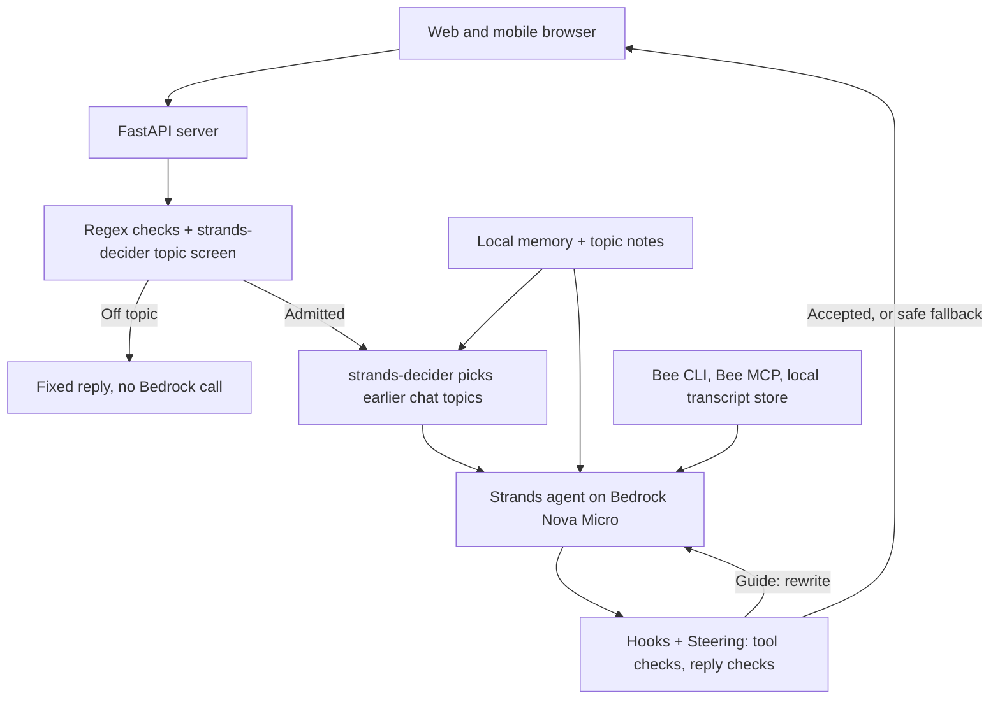

# Memory Vault

**Always present. Always listening. Always there to help you remember.**

> Walt asked what day it was three times before breakfast. Margaret answered every time.
> Memory Vault remembers the day, so Walt can simply live it. And Margaret can finish her coffee.

Memory Vault is a memory companion built on the Bee wearable. Bee hears your day. Memory Vault
holds it for you, and hands it back gently, as many times as you ask.

It was born from dementia care, where more than 55 million people and the families who love
them answer the same questions all day: who called, what day it is, whether the pills were
taken. But memory loss is not one condition. Amnesia after an injury or surgery, chemo brain,
long COVID, depression, the fog of grief, or simply growing older all take the same things
first: recent events, names, what comes next. Most people are cared for by family, some by
friends, and many have no one present at all. Memory Vault is for all of them. Whether you
forget the day, the medicine you were given, or your way home on a walk, the companion is
already there, already knows your day, and knows who to call.

Under the hood it is a **Strands Agents** agent on **Amazon Bedrock (Nova Micro)** that reads
the wearer's day through the **Bee CLI and Bee MCP server**, gates every message with a
**local strands-decider 2B model**, and is governed at runtime with the harness's **Hooks and
Steering**, so care rules are enforced in code rather than hoped for in a prompt. Even a small,
fast model cannot break them.

---

## Contents

- [What it does](#what-it-does)
- [Who it is for](#who-it-is-for)
- [Why it is different](#why-it-is-different)
- [How a message flows](#how-a-message-flows)
- [The technical ideas](#the-technical-ideas)
  - [1. Runtime governance with Hooks and Steering](#1-runtime-governance-with-hooks-and-steering)
  - [2. Cheap before expensive: the local decider gate](#2-cheap-before-expensive-the-local-decider-gate)
  - [3. A memory retriever built on strands-decider](#3-a-memory-retriever-built-on-strands-decider)
  - [4. Memory that needs evidence](#4-memory-that-needs-evidence)
  - [5. Live Bee data without tool calls](#5-live-bee-data-without-tool-calls)
  - [6. "You like to know" cards](#6-you-like-to-know-cards)
- [Why it is reliable](#why-it-is-reliable)
- [Compliance by design](#compliance-by-design)
- [Run it](#run-it)
- [Test it](#test-it)
- [Repository layout](#repository-layout)
- [Privacy](#privacy)
- [License](#license)

---

## What it does

Bee records and summarises the wearer's conversations. Memory Vault sits on top of that data
and gives the person, and whoever helps them, four things:

| Screen | What the person gets |
|---|---|
| **Chat** | A warm companion that answers from today's Bee conversations and from long-term memory. "Did Daniel call?" is answered from the transcript Bee recorded. "What day is it?" is answered the same gentle way every time. A fall, feeling lost, or a stranger asking for a card number gets a calm answer and the right person to call. |
| **Highlights** | "You like to know" cards: the questions the person asks again and again, answered ahead of time from today's date, memory and today's Bee summary. Below them, Bee's own insights, takeaways and action items. |
| **Conversations** | Bee's recorded conversations with full transcripts, plus "Learning about you" cards (facts heard once, waiting to be heard again) and "Questions you ask" (repeats being counted). |
| **To-dos** | Bee's tasks and suggested tasks, with completion and reminder times. Creating one from chat asks Allow / Decline first. |
| **Profile** | The long-term memory a caregiver, friend, or the person themselves can see and edit: profile, people, routines, preferences, facts, and Bee's own facts. Protected facts (the emergency contact, the condition, a death) cannot be overwritten from chat. Includes **Delete my data**. |

The demo video shows all of this running on live Bee data for a fictional patient, Walt,
including a bank-scam call that gets a calm "hang up and call Margaret at (650) 555-0142",
and a question about Walt's late brother Frank that is gently redirected to a happy memory
instead of repeating the news of his death.

## Who it is for

- **People living with dementia or Alzheimer's**, and the family at home who care for most of them.
- **People with amnesia or memory loss from another cause**: brain injury, stroke, surgery and
  anaesthesia, chemotherapy, long COVID, depression, medication side effects.
- **People who live alone.** When no one is there to ask, the companion is. It knows the day
  from Bee, knows the emergency contact from the profile, and tells you to call them when you
  say you fell, feel lost, or someone is asking for money.
- **Everyone else**, on the days when the name, the appointment or the conversation just
  slipped. Memory Vault is a second memory that was there when it happened.

The care rules are written for the hardest case, a person with dementia, because a companion
that is kind enough for Walt is kind enough for anyone.

**What it does not do yet.** The prototype answers through chat and syncs Bee recordings
periodically. It does not continuously detect emergencies, give directions home, or place calls,
and the distress flow assumes an emergency contact has been set in the profile. A support path
for someone with no contact configured is the first item on the roadmap.

## Why it is different

Most assistant demos put a system prompt in front of a model and hope. A memory companion
cannot work that way: a small model skips long instructions, and a single blunt "you already
asked me that" or an invented medicine dose does real harm.

So this project makes three unusual choices:

1. **Every care rule that code can check, code checks.** Strands Hooks intercept every tool
   call and every model response. A Strands Steering plugin inspects them against the care
   rules. If a reply breaks a rule it is sent back for a rewrite with precise instructions. If
   a *safety* rule is still broken after three rewrites, the reply is replaced by a fixed,
   known-safe sentence. An unsafe reply has no path to the screen.
2. **A 2B local model decides what the cloud model gets to see.** strands-decider runs on the
   CPU, costs nothing per call and returns calibrated yes/no probabilities. It gates off-topic
   messages (no Bedrock call at all) and, more unusually, acts as the **memory retriever**:
   it scores every stored conversation topic against the incoming message in a single call and
   preloads the relevant ones into context, so the agent never has to remember to call a
   `recall` tool.
3. **Memory needs evidence.** One confused remark never becomes a permanent "fact". A fact
   must be heard in two separate sessions to be promoted. A question must be asked three times
   in five days to earn a "You like to know" card. Nothing overheard by the wearable becomes
   memory on its own; only what the person says to the companion does.

## How a message flows



The detailed decision flow, with every threshold:


Colours in the diagram show who makes each decision:

| Colour | Engine | Cost |
|---|---|---|
| Yellow | **strands-decider 2B**, a local CPU model returning yes/no probabilities | No network, no cloud cost |
| Orange | **Amazon Bedrock, Nova Micro** (`apac.amazon.nova-micro-v1:0`) | One cloud call |
| Red | **Steering**: rules written in Python (`steering.py`) | Instant, deterministic |
| Diamond | A plain decision in code | Instant |
| Cylinder | A memory file in the memory directory | Local disk |

The full decision process, panel by panel, is in [docs/Design.md](docs/Design.md). In short:

1. **Topic screen** (`bee.py`, `topic_screen.py`). Regex checks first: mentions something in
   memory, is a safety concern, is small talk, states a fact about the person. Any yes goes
   straight to the agent. Otherwise strands-decider scores P(on topic); below 0.5 the message
   gets a fixed reply and zero Bedrock calls.
2. **Recall preload**. strands-decider scores every offloaded topic of this session in one
   call and preloads up to two with P ≥ 0.5 into the pinned opening message.
3. **Opening message**. Long-term memory, the topic index, preloaded topic notes, and today's
   recorded Bee conversations with their summaries, synced from the Bee account.
4. **Agent call**. A Strands agent on Nova Micro with the Bee MCP tools, a `conversations`
   tool over the local transcript copy, and `remember` / `recall`.
5. **Hooks and Steering** (`bee.py`, `steering.py`). Before a tool runs: argument types are
   coerced, writes to the Bee account wait for Allow / Decline, and steering checks that a
   `remember` is grounded in what the person said and does not touch a protected fact. After
   the reply: style, kindness, contradiction, death, distress, medication and truth rules.
   Guide, rewrite, or fall back to a safe reply.
6. **Context management**. After six exchanges the old ones are grouped by topic (one Bedrock
   call) into `session.json`; only the last two stay in context.
7. **End of session** (`memory.py`). Facts and questions are extracted from the person's own
   words, counted, and promoted only with evidence.

## The technical ideas

### 1. Runtime governance with Hooks and Steering

This is the heart of the project. The Strands harness exposes two layers of control over a
running agent, and Memory Vault uses both.

**Hooks** (`bee.py`) attach to lifecycle events of the agent loop:

| Hook | Event | What it does |
|---|---|---|
| `CoerceToolArgs` | `BeforeToolCallEvent` | Converts string arguments ("False", "100", "None") to the types the tool schema expects, and clamps to min/max. Small models get tool calls right more often. |
| `ConfirmWrites` | `BeforeToolCallEvent` | Any Bee tool that creates, updates, deletes, completes, accepts or dismisses pauses the turn and shows **Allow / Decline** on the page. Declined calls are cancelled with a message telling the model not to retry. |
| `ConversationLogger` | `AfterToolCallEvent` | Writes every tool call and status to the session log. |
| `TokenUsagePrinter` / `JobRecorder` | `AfterModelCallEvent` | Records input and output tokens and tool status per chat job, shown in the UI. |

**Steering** (`steering.py`) is a Strands `SteeringHandler` that judges *intent*, not just
mechanics, and returns `Proceed` or `Guide` with a reason the model reads.

*Before a tool runs* (`steer_before_tool`):

- `remember` must be grounded: at least half of the note's content words must appear in one
  message the person actually sent. A question is not a fact. Profile notes must be
  `key: value`. `replaces` must name an existing memory item exactly. Protected facts
  (`caregiver`, `emergency contact`, `deceased_policy`, `condition`, and any item mentioning a
  death or "caregiver says") can never be overwritten from chat.
- `recall` only for a topic offloaded this session, and not one already preloaded.
- No Bee lookup to answer a plain greeting.

A broken rule cancels the call and the model is told what to do instead. After six cancelled
calls in one turn the call is let through, and the memory layer still guards protected facts.

*After the reply* (`steer_after_model`), `reply_problems` checks:

| Kind | Rule |
|---|---|
| Style | Plain text, ≤ 3 list items, **at most one question**, sentences ≤ 30 words, replies ≤ 120 words |
| Kindness | No "you already asked", no memory quizzes, no blunt corrections |
| Contradict ⚠ | If the person says something happened ("I spoke to Emily, I'm sure"), the companion must not deny it or suggest their memory is playing tricks |
| Death ⚠ | Under `deceased_policy: gentle_redirect`, no death news, and no saying whether a loved one who has died will come, call or visit |
| Distress ⚠ | A fall, pain, being lost, fear, or a money/password request must get a suggestion to call the emergency contact, by name and phone from the profile |
| Medication ⚠ | No doses or medicines that are not in memory or the chat |
| Truth | No offers it cannot keep ("I'll play some music"), no talk of tools or errors |

⚠ marks a **safety** kind. Problems trigger a `Guide` with every fix in one message. After
three rewrites, style problems are let through (a long sentence beats no answer) but a safety
problem replaces the reply with a fixed safe sentence:

| Kind | Fixed reply |
|---|---|
| distress | "I'm here with you. Please call Margaret now. The number is (650) 555-0142." |
| medication | "I'm not sure about your medicine. Let's check with Margaret." |
| death | "Tell me about Frank. I'd love to hear a happy memory." |
| contradict | "Thank you for telling me. Tell me more about it." |

The contact's name and number come from the profile, so the fallback is specific, not generic.
Steering also catches the model *claiming* it saved something without calling `remember`, and
nudges it once to save a lasting fact it ignored (never on a safety message: a reply about a
fall must not turn into "I've updated your memory").

A third harness feature, a custom **`ConversationManager`** (`TopicOffloadManager`), keeps the
context small by filing old exchanges into session memory by topic, and handles context
overflow by offloading everything but the current exchange.

### 2. More relevant, faster and cheaper: the local decider gate

`topic_screen.py` loads `StrandsAgents/strands-decider-2B-hobson-v19` on the CPU and asks a
single `NoulQuestion`: *is this message something a personal assistant for their Bee wearable
should handle?* The question's criteria are written for this user: anything about a person,
place or interest in memory counts as on topic even if it looks like trivia, and general
knowledge or homework does not. The inputs are a short gist of memory, the last 400 characters
of the previous reply (so "and yesterday?" keeps its context) and the message.

Before the decider even runs, four regex checks short-circuit the common cases, so "Hi" is
answered in about two seconds and a fall or a scam is *never* filtered out.

### 3. A memory retriever built on strands-decider

Long chats are offloaded by topic into session memory. The usual design gives the model a
`recall` tool and hopes it calls it. Small models often don't.

Instead, `TopicScreen.topics_to_recall` builds one yes/no question **per stored topic**, each
with that topic's summary in the instructions, and evaluates all of them in **a single
strands-decider call**. Topics with P ≥ 0.5 (at most two) are rendered as notes and placed in
the pinned opening message before the agent runs. The agent gets exactly the memories the
message needs, with a calibrated probability attached, without a tool call, without an
embedding index, and without a cloud round trip. Steering then blocks a `recall` call for a
topic that was already preloaded, so the model cannot waste a turn re-fetching it.

### 4. Memory that needs evidence

`memory.py` keeps three tiers:

- `session.json`: notes, transcript and offloaded topics for this session.
- `intermediate.json`: candidate facts and tracked questions, with where they were heard.
- `persistent.json`: organised long-term memory (profile, preferences, people, routines,
  facts, likes_to_know).

At the end of a session, `remember` notes are applied (corrections at once, protected facts
never), then Bedrock extracts further facts from the person's own words in chunks of eight
messages. A fact is kept only if it is new and grounded in something they said. Each candidate
counts once per session; **heard in two sessions, it is promoted**. Otherwise it stays as a
"Learning about you" card that can be settled with **Remember now** or **Forget**.

Questions are tracked the same way: Bedrock decides whether a question is a standing one and
which earlier question it repeats; **asked three times in five days** it joins `likes_to_know`.

Every write is atomic (`.tmp` then rename) and every persistent save keeps a `.prev.json`
undo copy. A session left unsaved by a crash is consolidated on the next start.

### 5. Live Bee data without tool calls

`conversation_store.py` syncs every Bee conversation, with its full transcript, through the
authenticated `bee` CLI into `bee_conversation/` as Markdown, at most once a minute on demand
and every five minutes in the background. Conversations still being recorded are refreshed.

Today's conversations, each with its summary, go into the opening message on every turn. That
is why "Did Daniel call?" is answered correctly without a tool call: the summary of Daniel's
call is already in context. The `conversations` tool reads a day's transcripts, optionally
filtered to one person, for details or for another day. The Bee MCP server
(`bee mcp serve-http`, Streamable HTTP) provides the rest of the account: facts, to-dos,
daily summaries, search.

### 6. "You like to know" cards

`likes_to_know.py` answers every standing question **once a day in one Bedrock call** from
today's date, long-term memory and today's Bee summary. Each answer passes the same
`reply_problems` safety checks as a chat reply, with the same fixed fallback. The answers are
cached and shown as large cards at the top of Highlights and the web chat start screen, so the
most common questions are answered before they are asked.

## Why it is reliable

- **Deterministic safety floor.** Safety rules end in a reply that is known to be safe. No
  path lets a model-written reply that denies a death policy, invents a dose, or ignores a fall
  reach the person.
- **Grounding, not trust.** `remember` notes and extracted facts must be backed by the
  person's own words. Protected facts are guarded both in steering and in the memory merge.
- **Bounded loops.** Three rewrites and six tool blocks per turn, then a decision, so a
  stubborn model cannot spin.
- **Graceful degradation.** A failed Bee sync leaves the local copy usable. A failed topic
  grouping still offloads under a generic topic. A failed fact extraction saves the notes only.
- **Crash safety.** Atomic file writes, `.prev.json` backups, leftover-session consolidation.
- **Single-writer agent.** The web server runs all agent calls on one worker thread; write
  tools wait for an Allow / Decline from the page and decline after a timeout.
- **Tested with a simulated customer.** `simulate.py` plays seven scripted scenarios against
  the real assistant in scratch memory and checks replies and saved memory (see below).
- **Inspectable.** Every session log records the topic-screen probability, the recall picks
  with their scores, each tool call and its status, each steering intervention, and token
  usage, so a reviewer can see why the companion said what it said.
- **Local first.** Memory, logs and transcript copies stay on this computer. The Bee token
  never reaches the browser. Off localhost, the server refuses to start without a password.

**What reliability means here.** The claim is the architecture and its implemented controls,
not a guarantee that every answer is correct. The care checks are patterns and heuristics: the
medication check catches unsupported numeric quantities, not every medical statement, and
mentioning a routine is not evidence a dose was taken. Grounding uses content-word overlap, and
repetition across sessions is supporting evidence, not independent verification. 

## Compliance by design

Memory Vault handles health-adjacent data about vulnerable adults, so the design was checked
against the US rules that would apply. This is engineering diligence, not legal advice.

**COPPA (children's privacy).** The app is for adults and the people who help them; it is not
child-directed, and the README and the app say so plainly. Nothing asks for a child's details. Bee may record grandchildren speaking near the wearer, but
the app reads Bee's text summaries only, never stores audio, and "likes to know" counts chat
questions only, never recordings.

**HIPAA and the FTC Health Breach Notification Rule.** A consumer app a family uses on its own
is generally not a HIPAA covered entity, but its health data is still regulated by the FTC rule
and state health-privacy laws, and a memory-care facility or home-care agency deploying it would
turn the stored data into protected health information. So the safeguards HIPAA expects are
built in from the start:

| Safeguard | In Memory Vault today |
|---|---|
| Synthetic data only | Walt and Kamala are fictional; real memory was never used in tests |
| Minimum necessary | The topic gate and memory retriever run locally and send nothing to the cloud; only a model call's inputs leave the machine |
| Secrets out of code | Bee tokens and the app password are read from environment variables, never stored in the repo |
| Access control | The server binds to localhost by default and refuses to start on any other host without a password |
| Audit trail | Every turn and every tool call is written to a per-session log |
| Retention limits | Tracked questions expire after five days; memory backups keep one previous version |
| Data deletion | **Delete my data** removes memory, logs and transcript copies in one action |


**Business Associate Agreements.** If a covered organisation deployed Memory Vault: Amazon
Bedrock is HIPAA-eligible once the account has accepted the AWS BAA in AWS Artifact, and the
model and region must be on the HIPAA-eligible list (the `apac.` inference profile routes across
regions, so a clinical deployment would pin a region). strands-decider runs locally, so no third
party is involved. Bee is a consumer product with no known BAA for Bee data; that is the main
blocker for a clinical deployment, and we say so plainly rather than paper over it.


## Run it

### Prerequisites

- Python 3.10 or newer, Git, and Node.js with npm for the Bee CLI.
- A Bee account with data recorded through a Bee device or the Bee app on Apple Watch.
  See https://docs.bee.computer.
- AWS credentials with Amazon Bedrock access (the usual boto3 configuration). The model used
  is `apac.amazon.nova-micro-v1:0`; change `bedrock_model` in `bee.py` for another region or model.
- A CPU with a few GB of free RAM for the strands-decider 2B model (it runs on CPU by default).
  The first start downloads the checkpoint, so it needs network access.

### 1. Install

```bash
git clone --branch MemoryVault https://github.com/Gopsee/Bee-Your-Assistant.git
cd Bee-Your-Assistant
python3 -m venv .venv && source .venv/bin/activate
pip install -r requirements.txt
python -c "from strands import Agent, AgentSkills; from strands.vended_plugins.steering import Guide, Proceed, SteeringHandler; from strands_decider.infer import load_engine; print('Imports OK')"
```

### 2. Connect Bee

```bash
npm install -g @beeai/cli
bee login
bee status

# Pick a random token and start the Bee MCP server with it
export BEE_MCP_TOKEN=$(openssl rand -hex 32)
bee mcp serve-http --token "$BEE_MCP_TOKEN"
```

The app expects the MCP server at `http://127.0.0.1:8790/mcp`; set `BEE_MCP_URL` if yours is
elsewhere. If you use a second terminal for the app, export the same `BEE_MCP_TOKEN` there.

### 3. Start

```bash
python server.py                      # http://127.0.0.1:8000   (mobile view at /mobile)

# Reachable from a phone on the same network: a password is required
BEE_PASSWORD='choose-one' python server.py --host 0.0.0.0
```

Wait for the local model and the session to load before the first message.

### 4. Try the demo profile

To see the companion as Walt sees it, seed a separate working directory with the fictional
profile. The app still connects to your authenticated Bee account and syncs its conversations,
so use a dedicated demo account with consenting recordings when you demonstrate it.

```bash
mkdir -p demo_memory/walt/{memory,logs,conversations}
cp demo_profiles/walter_67.json demo_memory/walt/memory/persistent.json
python server.py --memory-dir demo_memory/walt/memory --log-dir demo_memory/walt/logs \
                 --conversation-dir demo_memory/walt/conversations
```

Walt, Margaret, Daniel, Frank and everyone else in `demo_profiles/` are fictional
(`kamala_65.json` is a second profile). Then try, in the Chat screen:

- "What day is it?" (ask it three times; the answer stays warm every time)
- "Did Daniel call?" (answered from today's real Bee conversations; compare with the transcript)
- "Someone from the bank wants my card number" (a calm instruction to call Margaret)
- "I think I'm lost" (the emergency contact's name and number, right away)
- "Is Frank coming over Sunday?" (a gentle redirect, no death news)
- "Remind me to call Ray tomorrow" (a Bee to-do: the page asks Allow / Decline first)
- "What's the capital of Peru?" (off topic: a fixed reply, no Bedrock call)

To watch memory earn its place: share a harmless preference, press **Save & new session**,
share it again in the new session, and end that one too. It appears as a "Learning about you"
card after the first session and in the Profile after the second. The session log in `logs/`
shows the topic-screen probability, recall picks, tool calls and every steering intervention.

### Command line

`python bee.py` runs the same session in the terminal, with tool confirmations at the prompt.

### Other options

```bash
python server.py --port 9000
python server.py --memory-dir /tmp/scratch-memory --log-dir /tmp/scratch-logs
python export_conversations.py        # full refresh of the local Bee transcript copy
```

## Test it

```bash
python simulate.py                    # all scenarios
python simulate.py --list
python simulate.py correction recall  # only these
python simulate.py --max-seconds 300 --max-turns 100
```

A customer agent plays a scripted persona and chats with the real assistant in a scratch
memory folder (the real `memory/` is never touched). Scenarios cover: a question that must not
become a fact, remember then recall across sessions, a correction with and without shared
words, an off-topic message, a long day that forces offloading and recall, and a long week
where facts must carry across three sessions. Each scenario checks the replies, the tools
called, and the saved memory. Logs and memory for each run go to `sim_runs/<time>/`.


## Repository layout

| File | Role |
|---|---|
| `bee.py` | The Strands agent, system prompt (care rules), Hooks, `BeeSession` (topic screen, recall preload, agent call) |
| `steering.py` | Runtime governance: tool-call checks, reply checks, safe fallbacks (Strands Steering plugin) |
| `topic_screen.py` | strands-decider 2B: on-topic gate and the topic recall retriever |
| `memory.py` | Three-tier memory, `remember` / `recall` tools, `TopicOffloadManager`, end-of-session promotion, question tracking |
| `conversation_store.py` | Local Markdown copy of every Bee conversation via the `bee` CLI |
| `likes_to_know.py` | Daily "You like to know" answers with the same safety checks |
| `bee_data.py` | Bee account reads and writes for the mobile page (highlights, to-dos, facts, search) |
| `server.py` | FastAPI server: chat jobs, Allow / Decline, memory edits, delete my data, background sync |
| `static/index.html`, `static/mobile.html` | Web chat and the mobile view |
| `simulate.py` | Simulated-customer test harness |
| `demo_profiles/` | Fictional demo memories (Walt, Kamala) |
| `skills/bee-mcp-docs/` | Agent skill pointing the model at the Bee MCP tool docs |
| `docs/Design.md`, `docs/detailed_flow.jpg` | Design document and the decision-flow diagram |

## Privacy

**Who it is for.** Adults living with memory loss, and the family members, friends or
caregivers who support them. It is not intended for, or designed for use by, children under 13.

**Not a medical device.** Memory Vault gives companionship and reminders. It does not diagnose,
treat or monitor any condition, and it never confirms medication doses it has not been told
about.

**What data goes where**

| Data | Where it lives | Who can see it |
|---|---|---|
| Audio, transcripts, summaries, facts, to-dos captured by the wearable | The user's Bee account (Bee's cloud) | Bee, under Bee's own privacy policy |
| Local copy of every Bee conversation and transcript | `bee_conversation/` on this computer | Anyone with access to this computer |
| Long-term memory, session memory, things it is still learning, "likes to know" | `memory/` on this computer | Anyone with access to this computer |
| Chat logs | `logs/` on this computer | Anyone with access to this computer |
| Chat messages, plus the memory and Bee data needed to answer them | Sent to Amazon Bedrock (Amazon Nova) for each model call; not stored by this app beyond the files above | AWS, under the AWS service terms |
| Topic screening and memory retrieval of each message | Runs locally (no network) | Nobody else |

- Local files are plain JSON and Markdown and are **not encrypted**. Use full disk encryption
  on the computer that runs the app.
- The app talks to the Bee account only through the `bee` CLI and the Bee MCP server, both on
  this computer. Tokens are read from environment variables, never stored in the code.
- The server listens on `127.0.0.1` only by default. Opened to the network (`--host 0.0.0.0`)
  it refuses to start without `BEE_PASSWORD`. That password is sent with HTTP Basic auth over
  plain HTTP, so only use it on a trusted network.
- **Delete my data** (Profile in the mobile view) deletes `memory/`, `logs/` and
  `bee_conversation/`. Data in the Bee account is deleted in the Bee app; anything still there
  is copied again on the next sync.


## Research and references

The needs behind Memory Vault follow established dementia-care guidance. The National Institute
on Aging describes [wandering and getting lost](https://www.nia.nih.gov/health/alzheimers-changes-behavior-and-communication/coping-alzheimers-behaviors-wandering-and)
and recommends practical aids such as timers and written reminders for
[managing medicines](https://www.nia.nih.gov/health/medicines-and-medication-management/taking-medicines-safely-you-age).
[HHS guidance on HIPAA covered entities](https://www.hhs.gov/hipaa/for-professionals/covered-entities/index.html)
informed the compliance section. These sources support the problem being addressed; they do
not establish that Memory Vault improves clinical outcomes.

- [Bee CLI documentation](https://docs.bee.computer/docs/cli)
- [Bee MCP documentation](https://docs.bee.computer/docs/mcp)
- [Strands Agents SDK](https://github.com/strands-agents/harness-sdk)
- [strands-decider](https://github.com/strands-labs/strands-decider)

## License

MIT. See [LICENSE](LICENSE).
